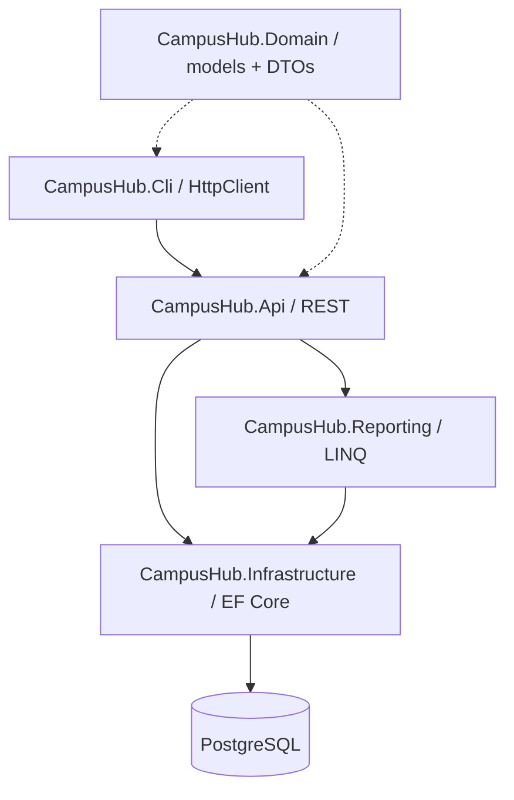

# 🎓 PADO CampusHub

### Student & Course Management Platform · ASP.NET Core / .NET 10

[](https://github.com/PADOALEX/PADO-CampusHub/actions/workflows/ci.yml)
   

> **Verification note:** Source and configuration passed static checks; `.NET build`, tests and Docker start still need to run on a machine with the .NET 10 SDK. See [verification status](docs/VERIFICATION.md).

A portfolio-scale learning platform unifying three original C# exercises: student/course API, interactive database console manager and a 12-query LINQ reporting exercise. This is a **single shared schema, one source of truth and one .sln**, not three loosely joined programs.

## Highlights

- ASP.NET Core Web API with student/course CRUD, safe student JSON Patch, enrollments and grades.
- PostgreSQL + EF Core, initial migration, unique normalized email, composite enrollment PK and database constraints.
- Race-aware seat assignment: PostgreSQL transactions + per-course row locking, duplication/capacity checks.
- Console client uses `HttpClient` — **no direct database access**.
- Dedicated SQL-backed LINQ report module with the **12 original tasks**, including group filtering, >85, top 3, under-18, averages, best student/group and counts.
- Pagination, filtering, sorting, DTO validation, ProblemDetails error responses, Swagger UI, health endpoint.
- Unit tests, API integration tests, Docker Compose, opt-in seed data and GitHub Actions CI with a PostgreSQL smoke test.

## Architecture



The full ER diagram, product rules and conflict resolution are in [Architecture](docs/ARCHITECTURE.md) and [Source migration audit](docs/MIGRATION-AUDIT.md) and [12-report operator map](docs/REPORTS.md).

## Quick start (Docker, recommended)

Install Docker Desktop with Compose. Then:

```bash
cp .env.example .env
# edit .env: choose a unique local POSTGRES_PASSWORD
docker compose up --build -d
```

On Windows PowerShell, use `Copy-Item .env.example .env` instead of `cp` if needed.

| Resource | URL |
| --- | --- |
| API | http://localhost:8080 |
| Swagger | http://localhost:8080/swagger |
| API health | http://localhost:8080/health |
| Students | http://localhost:8080/api/students |
| LINQ reports | http://localhost:8080/api/reports/legacy?group=PMA-21 |

Compose waits for PostgreSQL to be healthy, runs the initial migration and inserts 12 synthetic students plus 3 courses on the first start. API and PostgreSQL host ports are bound to **127.0.0.1** for local demonstration only.

```bash
docker compose logs -f api
docker compose down           # preserves database volume
docker compose down -v        # destroys demo database (irreversible)
```

## Local .NET 10 development

Requirements: .NET 10 SDK and PostgreSQL 17 (or a Compose PostgreSQL container). Create and configure a local connection string; **do not commit passwords**.

```powershell
$env:ConnectionStrings__DefaultConnection="Host=localhost;Port=5432;Database=campushub;Username=campushub;Password=YOUR_LOCAL_PASSWORD"
$env:Database__MigrateOnStartup="true"
$env:SeedData__Enabled="true"
dotnet restore PADO.CampusHub.sln
dotnet build PADO.CampusHub.sln -c Release
dotnet run --project src/CampusHub.Api -- --urls http://localhost:8080
```

In a **second terminal**:

```powershell
dotnet run --project src/CampusHub.Cli -- http://localhost:8080
```

Apply a migration explicitly instead of auto-migration, if preferred:

```bash
dotnet tool install --global dotnet-ef --version 10.0.5
dotnet ef database update --project src/CampusHub.Infrastructure --startup-project src/CampusHub.Api
```

EF tooling can read the connection from `ConnectionStrings__DefaultConnection`. With auto-migration disabled (default), starting the API will **not** silently modify the schema.

## Test and verify

```bash
dotnet restore PADO.CampusHub.sln
dotnet build PADO.CampusHub.sln -c Release --no-restore
dotnet test PADO.CampusHub.sln -c Release --no-build
```

The xUnit tests use SQLite in-memory with real relational constraints, and ASP.NET Core `WebApplicationFactory` for HTTP integration; they do not require a running PostgreSQL instance. GitHub Actions additionally starts real PostgreSQL 17, migrates, seeds and smoke-tests the API. PostgreSQL concurrent-registration behaviour deserves additional high-load verification in an appropriate environment.

## API map

| Method | Endpoint | Purpose |
| --- | --- | --- |
| GET/POST | `/api/students` | Student page / create |
| GET/PUT/PATCH/DELETE | `/api/students/{id}` | Details / full update / restricted JSON Patch / delete |
| GET/POST | `/api/courses` | Course page / create |
| GET/PUT/DELETE | `/api/courses/{id}` | Details / update / delete |
| POST | `/api/enrollments` | Register `{studentId,courseId}` |
| GET | `/api/enrollments/student/{id}` | Courses registered by student (with statuses) |
| GET | `/api/enrollments/course/{id}` | Students registered for course (with statuses) |
| PUT | `/api/enrollments/{studentId}/{courseId}/grade` | Assign `{grade: 91.5}` |
| PUT | `/api/enrollments/{studentId}/{courseId}/status` | Assign `{status: "Completed"}` |
| DELETE | `/api/enrollments/{studentId}/{courseId}` | Cancel registration, preserving history |
| GET | `/api/reports/legacy?group=PMA-21&limit=1000` | All legacy 12 LINQ reports |
| GET | `/api/reports/course-stats` | Course occupancy statistics |

Students support `page`, `pageSize` (1–100), `search`, `group`, `olderThan`, `sort=id|name|age|grade`, `descending`. Courses support `search`, `longerThan`, `sort=id|title|duration`, and the same page controls. GET pages return `{items,page,pageSize,totalCount}`.

### Example request

```bash
curl -X POST http://localhost:8080/api/students \
  -H "Content-Type: application/json" \
  -d '{"firstName":"Alex","lastName":"Pado","email":"alex@campushub.example","groupName":"PMA-21","age":19}'
```

More executable examples: [`CampusHub.Api.http`](src/CampusHub.Api/CampusHub.Api.http).

## Data behaviour and limits

- Demo seed data comes from the exact 12-record legacy `students.txt` file. Synthetic emails use `.invalid`; no real student data is assumed.
- Old `AverageGrade` is a **historical overall snapshot**. Grades tied to a course are stored on `Enrollment`. If any graded **completed** courses exist, reports use their average; otherwise they use the historical value.
- `Active` registrations occupy seats. `Completed` and `Cancelled` release them. Completion is final; a cancelled enrollment may be restarted; an already active/completed registration is a conflict (HTTP 409).
- Student/course DELETE is destructive with cascade; enrollment DELETE is non-destructive cancellation.
- Classic report lists explicitly cap output (`limit` defaults to 1000) instead of loading the entire database; `isTruncated` signals omitted rows.
- No login or role system is included. It is an **educational local portfolio backend**, not a publicly deployable personal-data service without authentication, authorization, backups and privacy review.

## Original source → new solution

| Original archive | Where it went |
| --- | --- |
| `StudentCourseApi.zip` | API controllers, StudentService, DTO structure, EF migration and tests were redesigned in Api / Domain / Infrastructure / tests |
| `StudentCourseApp.zip` | Full CRUD and five special queries became CLI HTTP calls and API endpoints; original PostgreSQL connection removed |
| `LinqStudentsProject.zip` | Twelve LINQ reports became database-backed CampusHub.Reporting; original `students.txt` is now opt-in demo seed |

The precise field conflicts, legacy database safety caveats and all 12 mapping decisions are documented in [docs/MIGRATION-AUDIT.md](docs/MIGRATION-AUDIT.md).

## Portfolio context

**Stack:** C# · .NET 10 · ASP.NET Core · EF Core · PostgreSQL · LINQ · HttpClient · Docker Compose · xUnit · Swagger/OpenAPI · GitHub Actions.

**Motivation:** Turn three independent university assignments into one coherent, testable client-server platform with explicit data ownership, relational integrity and reporting semantics.

---

© 2026 PADO. MIT License.  
**Maintainer:** [PADOALEX](https://github.com/PADOALEX)

## Publishing to GitHub

Once local `dotnet build` and `dotnet test` pass, run `pwsh ./scripts/publish.ps1` (or `./scripts/publish.ps1` in Windows PowerShell) after `gh auth login`. This intentionally refuses to publish on a failing build or tests and creates **one `main` branch**. Repository creation requires GitHub CLI authorization; it cannot be performed offline from this source package.
