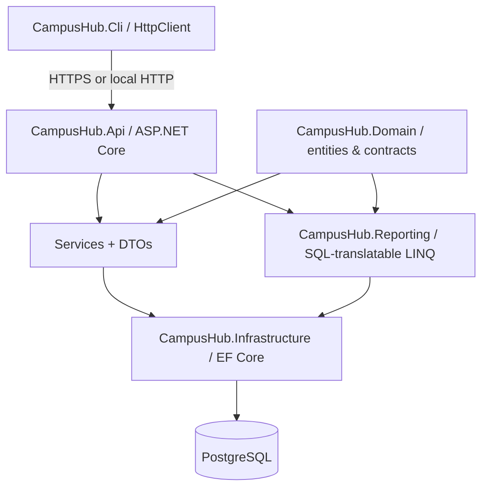

# Architecture and business rules



## Data model

```mermaid
erDiagram
  STUDENT ||--o{ ENROLLMENT : registers
  COURSE ||--o{ ENROLLMENT : contains
  STUDENT { int Id PK
    string FirstName
    string LastName
    string Email UK
    string GroupName
    int Age
    decimal LegacyAverageGrade
  }
  COURSE { int Id PK
    string Title
    int DurationHours (nullable)
    int Capacity
  }
  ENROLLMENT { int StudentId PK,FK
    int CourseId PK,FK
    string Status
    decimal Grade
    datetime EnrollmentDateUtc
  }
```

- `Student` holds demographic data plus an **optional original overall grade** from `students.txt`. A student can exist without enrollment.
- `Enrollment.Grade` is a **per-course grade**, distinct from historical average. The effective overall average used in reports is AVG of graded **completed** enrollments, falling back to `LegacyAverageGrade` if none exist. This is a deliberately documented product rule, not an accidental arithmetic mix.
- `Status` is `Active`, `Completed`, or `Cancelled`. Active consumes one seat; completing or cancelling releases it. A cancelled registration can be reactivated via POST (if seats remain); a completed enrollment is a final status. Composite PK prevents duplicate registration records.
- Capacity is a course limit; PostgreSQL enrollment and capacity update transactions lock the course row with `SELECT ... FOR UPDATE`. The relational SQLite test provider uses regular transactions; exact PostgreSQL concurrency should additionally be tested in a real PostgreSQL environment.
- Email is unique through normalized uppercase storage, so ordinary case differences cannot create a duplicate.
- Student/course deletion cascades enrollment rows and is destructive; cancelling one enrollment retains its history.
- `GET /api/reports/legacy` implements all 12 original report tasks, issues SQL aggregates, projections, sorted/limited queries and has an explicit limit (3–10000 rows in list sections) to avoid accidental full-table materialization.
- The CLI has **no EF Core/Npgsql references** and cannot access PostgreSQL on its own.
- The application has no authentication and is a local demonstration system, **not designed for exposure to untrusted networks**. Add roles/authentication before public hosting.

## Why a separate Reporting project?

A typed reporting layer preserves legacy analytics while querying the **same** `AppDbContext`. Reports do not load a second `students.txt`, nor keep a separate copy of student state. It also keeps HTTP and EF persistence concerns out of the CLI.
